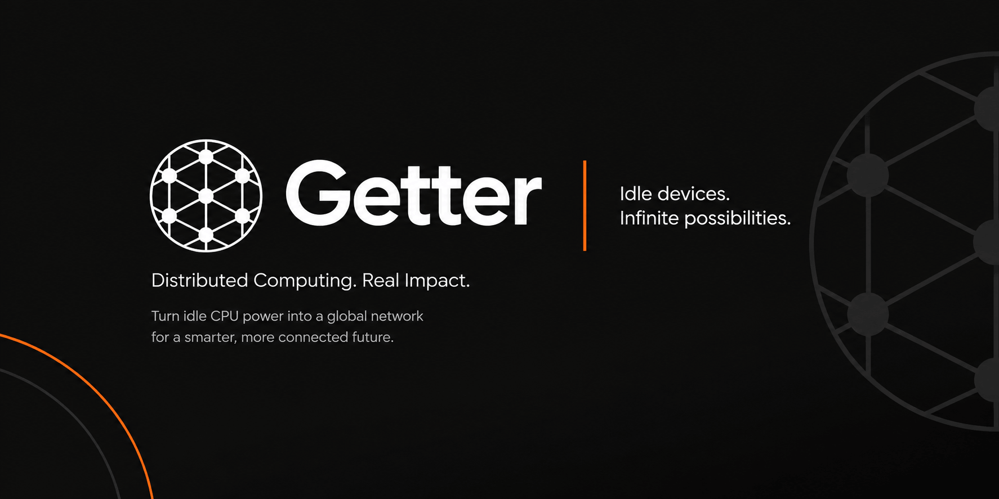
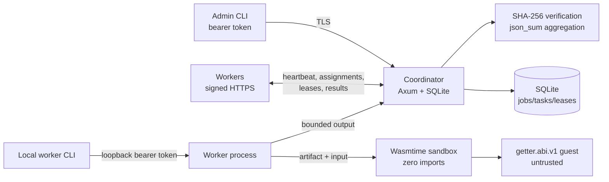

<p align="center">
  
</p>

# Getter

[](https://github.com/benaiah-muga/Getter/actions/workflows/ci.yml)
[](rust-toolchain.toml)
[](LICENSE)
[](CHANGELOG.md)

Getter turns idle CPUs on machines you control into a small distributed compute
network. A **coordinator** stores jobs and schedules independently executable
WebAssembly tasks; **workers** enroll with a one-time token, enforce their own
CPU, memory, time, fuel, output, and download limits, and run untrusted guest
code in a capability-free Wasmtime sandbox. Results are checked against trusted
per-task SHA-256 references and aggregated deterministically by the coordinator.

Getter is local-first: no cloud account, no telemetry, no internet at runtime,
and no special privileges. TLS and a pinned local CA are on by default.

> **Alpha status.** `0.1.0` has no signed release and no external third-party
> audit. An independent pre-release security review was completed and
> critical/high findings were addressed; that is not an audit report. The Wasm
> sandbox, verification model, replay handling, and LAN procedure have important
> caveats. Read [Limitations](docs/limitations.md),
> [Security](docs/security.md), and the [threat model](docs/threat-model.md)
> before relying on it.

## Mission

Make spare compute useful and inspectable on a trusted local network, with
explicit enrollment and bounded execution instead of implicit trust:

- one coordinator, many workers, no central cloud dependency;
- deterministic Wasm workloads with a strict zero-import sandbox;
- trusted reference hashes and coordinator-side aggregation;
- resource limits enforced by the worker, not just requested by the job;
- recoverable leases and durable job state in a single local SQLite database;
- honest statistics and honest documentation about what is not guaranteed.

## Features

- **Coordinator:** Axum HTTP(S), SQLite/WAL persistence, forward-only migrations,
  leased scheduling, lease-expiry recovery, retry ceilings, cancellation,
  artifact storage, status/contribution APIs, optional UDP discovery.
- **Worker:** outbound polling, Ed25519-signed requests, loopback-only
  bearer-token control API, concurrency/slot accounting, local resource ceilings,
  download digest checks, graceful leave, Unix niceness, Linux battery pause.
- **Sandbox:** Wasmtime 49.0.4, zero imports/WASI, fuel plus wall-clock epoch
  deadline, memory/table/instance limits, output bounds, module/input/output
  limits, cooperative cancellation, fresh instance per task.
- **Workload SDK:** `getter_workload!` macro, `getter.abi.v1` allocation/packing,
  no third-party dependencies, deliberately no host capabilities.
- **Verification:** `exact_sha256` per task, optional `trusted` development mode,
  `json_sum` aggregation with checked `u128`, optional exact expected aggregate.
- **CLI:** init, coordinator/worker lifecycle, pairing, local control, job
  submit/list/inspect/cancel/watch, status, workers, contribution, doctor,
  config show/set/path, discovery, uninstall.
- **Security defaults:** generated local CA, CA-fingerprint pinning, one-time
  name-scoped pairing tokens, hashed lease tokens, constant-time admin compare,
  `0700`/`0600` Unix state, loopback-only worker control.
- **Example:** deterministic partitioned sum of squares (`12` tasks,
  `12,000,000` values), checked-in Wasm, trusted hashes, expected total
  `575999928000002000000`.

## Architecture



The **control plane** (coordinator) owns authentication, admission, scheduling,
leases, verification, aggregation, and persistence. The **compute plane**
(worker) downloads artifacts, executes one task per sandbox instance, enforces
local maxima, and reports results. Workers only initiate connections; the only
worker listener is the loopback control API. See
[Architecture](docs/architecture.md) and [Protocol](docs/protocol.md).

## Requirements

- Linux (primary development platform), x86_64. macOS/Windows builds are not
  verified.
- Rust `1.97.0` via [`rust-toolchain.toml`](rust-toolchain.toml) and the checked-in
  [`Cargo.lock`](Cargo.lock).
- A C toolchain for bundled SQLite.
- `wasm32-unknown-unknown` only if you build workloads:
  `rustup target add wasm32-unknown-unknown`.
- Python 3.10+ only for `generate_job.py` and the E2E harness.
- No internet or cloud account at runtime.

## Installation

There are **no published binaries or signed releases** yet. Build from source:

```sh
git clone https://github.com/benaiah-muga/Getter.git
cd Getter
rustup show active-toolchain       # 1.97.0
cargo build --locked --release
./target/release/getter --version  # getter 0.1.0
```

Optionally install the binary:

```sh
install -m 0755 target/release/getter ~/.local/bin/getter
```

Build the reference workload only if you changed or want to rebuild it:

```sh
rustup target add wasm32-unknown-unknown
./scripts/build-example.sh
python3 examples/sum-squares/generate_job.py
```

The checked-in artifact is
`sha256:853269c113a222f5229bd5ce245ebe668d1c2978dc047554d8748e9e2246930e`.

## Quick start (one host, loopback TLS)

This uses three terminals. Run all commands from the repository root. The
coordinator uses loopback TLS with a generated local CA; workers pin its
fingerprint. Replace `<TOKEN>` and `<sha256:...>` with the values printed by
`getter pair`. This section uses the `GETTER` alias; the installed equivalents
are `getter worker join ...` and `getter jobs submit ...`.

**Terminal A — coordinator**

```sh
GETTER=./target/release/getter

$GETTER --home ./.getter-coord init \
  --role coordinator \
  --name home-coordinator \
  --bind 127.0.0.1:47810

$GETTER --home ./.getter-coord coordinator start
```

**Terminal B — create a pairing token, then a worker**

```sh
GETTER=./target/release/getter

$GETTER --home ./.getter-coord pair \
  --name local-worker --ttl-secs 600

$GETTER --home ./.getter-w1 init \
  --role worker \
  --name local-worker \
  --control-bind 127.0.0.1:47811

$GETTER --home ./.getter-w1 worker join \
  --coordinator https://127.0.0.1:47810 \
  --token '<TOKEN>' \
  --ca-fingerprint '<sha256:...>'

$GETTER --home ./.getter-w1 worker start
```

The pairing token is one-time, name-scoped, and expires. It is a secret and is
shown once. Prefer `--token-file` over `--token` if you are scripting; write the
file with `umask 077` and delete it after enrollment.

**Terminal C — submit and verify**

```sh
GETTER=./target/release/getter

$GETTER --home ./.getter-coord jobs submit \
  --file examples/sum-squares/job.json --watch

$GETTER --home ./.getter-coord status
$GETTER --home ./.getter-coord jobs list
$GETTER --home ./.getter-coord jobs inspect <job-id>
$GETTER --home ./.getter-coord contribute
$GETTER --home ./.getter-w1 worker status
```

A successful reference run shows `completed`, `12/12` tasks `verified`, and:

```json
{"total":"575999928000002000000"}
```

Stop foreground processes with Ctrl-C (coordinator and worker) or
`getter --home ./.getter-w1 worker stop`. Local state lives in the two
`.getter-*` directories; `getter uninstall --yes` removes one home and does not
touch service units.

## Two-worker example

Add a second worker on the same host. It needs a **different home, name, and
loopback control port**. Pair a second token on the coordinator and use a new
terminal:

```sh
GETTER=./target/release/getter

$GETTER --home ./.getter-coord pair --name local-worker-2 --ttl-secs 600

$GETTER --home ./.getter-w2 init \
  --role worker \
  --name local-worker-2 \
  --control-bind 127.0.0.1:47821

$GETTER --home ./.getter-w2 worker join \
  --coordinator https://127.0.0.1:47810 \
  --token '<TOKEN-2>' \
  --ca-fingerprint '<sha256:...>'

$GETTER --home ./.getter-w2 worker start
```

Wait for both workers to report online:

```sh
$GETTER --home ./.getter-coord workers
```

Then submit the same job. With two workers, the 12 tasks are distributed across
both; `jobs inspect` shows two distinct worker names, and `contribute` reports
per-worker completed tasks and compute time. The local kill/restart harness
(`scripts/e2e-local.sh`) automates this flow and has passed on the development
host; see [Testing](docs/testing.md) for exactly what it verifies.

## LAN deployment

For machines on the same trusted network, use explicit addressing and verify the
CA fingerprint out of band. A minimal coordinator setup:

```sh
getter --home ~/.getter init \
  --role coordinator --name lab-coordinator \
  --lan --hostname getter.lan
getter --home ~/.getter coordinator start
```

Workers then join with `https://<coordinator-address>:47810` and the fingerprint
from `getter pair`. Firewall inbound TCP `47810` (or your configured port); allow
UDP `47812` only if discovery is used. Discovery is unauthenticated and never
auto-enrolls. See [Local network](docs/local-network.md) for firewall, offline,
systemd, multiple-worker, and fallback instructions.

> **Unverified:** the LAN procedure has not been tested on separate physical
> machines in this environment. Test in an isolated lab and do not skip the
> fingerprint check.

## Validation and verification

- The CLI checks the Wasm file's SHA-256 before upload; the coordinator checks it
  again before storing and the worker checks the downloaded bytes.
- `verification.mode = "exact_sha256"` requires every task's trusted
  `expected_output_sha256`. The coordinator recomputes SHA-256 over the exact
  received output and rejects a mismatch. Worker-declared digests are not trusted
  for acceptance.
- `aggregation.mode = "json_sum"` parses each output as JSON and sums one
  unsigned integer/decimal field with checked `u128`; the coordinator never
  executes workload code.
- An optional `expected_aggregate` is compared exactly and fails the job on a
  mismatch.
- `verification.mode = "trusted"` is an explicit coordinator opt-in that accepts
  unverified results for development. It is not a correctness claim.

**What this does not prove.** Checksums validate against the job author's
reference values; they are not general computation honesty, independent
replication, or a fraud proof. A malicious admin can author a job that validates
malicious output. The sandbox is defense in depth, not a formal proof.
Compilation of a newly seen Wasm module is outside fuel and guest wall-clock
bounds; the replay guard is process-local; LAN discovery is unauthenticated. An
independent pre-release security review completed and critical/high findings
were addressed, but no external audit report is claimed. See
[Security](docs/security.md) and the [threat model](docs/threat-model.md).

## Worker resource controls

Workers enforce ceilings locally; jobs can request less but never raise them.
Defaults: concurrency `CPUs−1` clamped 1–4, 256 MiB per task, 300 s timeout,
1 MiB output, 5,000,000,000 fuel, 16 MiB artifact download, 750 ms poll, 5 s
heartbeat, loopback control `127.0.0.1:47811`, niceness 10, pause on battery.

```sh
getter --home ./.getter-w1 config set worker.concurrency 2
getter --home ./.getter-w1 config set worker.max_task_memory_bytes 536870912
getter --home ./.getter-w1 config set worker.max_output_bytes 262144
getter --home ./.getter-w1 config set worker.pause_on_battery false
getter --home ./.getter-w1 config set worker.niceness none
# restart the worker to apply
```

`max_download_bytes` and artifact limits cap download **size**, not bandwidth;
there is no traffic shaping. Battery pause is Linux-only and idle-user detection
is not implemented. `control_bind` must be loopback and unique per worker on a
host; its bearer token is not server authentication. See
[Configuration](docs/configuration.md).

## Security summary

- TLS is on by default with a local CA; workers pin the CA certificate or its
  SHA-256 fingerprint. There are no TLS client certificates; workers authenticate
  requests with Ed25519 signatures over method, path/query, timestamp, nonce, and
  body hash.
- Admin endpoints use a `0600` bearer token; worker control is loopback-only with
  a separate `0600` token. Pairing tokens are one-time, name-scoped, and expiring;
  lease tokens are short-lived and hashed at rest.
- Workers enforce their own limits; the coordinator also bounds job count, input,
  declared output, artifact, body, and result sizes. Default coordinator caps:
  16 MiB artifact, 16 MiB total input, 64 MiB total declared task output, 1 MiB
  per result, 48 MiB HTTP body; enrollment JSON is independently capped at
  64 KiB. A per-worker signed-request guard throttles nonce/replay traffic
  (admin/public rate limiting is **not** implemented).
- Use `--token-file` for pairing, protect homes/backups, keep clocks within 90 s,
  and never set `allow_insecure_remote = true` outside an isolated lab.
- Report vulnerabilities privately via
  [SECURITY.md](SECURITY.md#reporting-a-vulnerability). Do not open a public issue.

### Explicit security caveats

Wasm sandboxing is not a proof; checksums are integrity/reference correctness,
not general computation honesty; compilation of a newly seen module is not
covered by fuel or the guest timeout; the replay guard is process-local; LAN
discovery is unauthenticated; physical-LAN operation is untested. An independent
pre-release review completed and critical/high findings were addressed, but no
external audit is claimed. These are not footnotes to hide: they define the
current trust model. See the [threat model](docs/threat-model.md).

## Limitations

- Alpha `0.1.0`; no signed release, published binaries, SBOMs, or external
  third-party audit report.
- At-least-once, not exactly-once; workloads with external side effects must
  tolerate re-execution.
- No coordinator HA, federation, P2P transfer, WASI/imports, idle-user detection,
  bandwidth shaping, remote attestation, online CA rotation, or per-job worker
  ACL.
- No built-in retention/GC; SQLite and artifact/output storage grow with history.
- No admin/public rate limiting or metrics endpoint. Worker request throttling
  is process-local and resets on restart along with replay protection. SQLite
  work serializes behind one mutex, per-task memory limits aggregate across
  concurrency, and the loopback bearer token is not server authentication.
- The automated kill/restart E2E harness has passed on the development host;
  no GitHub Actions run is claimed for this snapshot. Physical LAN operation is
  a documented, unverified procedure. Enrollment and claim responses are not
  transport-idempotent: a lost response can consume a pairing token or delay a
  claimed task until lease expiry.
- macOS/Windows behavior is not verified; battery pause is Linux-only.
- See the full [Limitations](docs/limitations.md).

## Project layout

```text
crates/
  getter-protocol/      wire types, HTTP paths/headers, discovery, limits
  getter-core/          config, init/state, auth, scheduler, states, validation
  getter-storage/       SQLite, migrations, jobs/tasks/leases, enrollment
  getter-runtime/       Wasmtime sandbox, ABI, execution limits
  getter-coordinator/   Axum HTTP(S), handlers, sweeps, discovery
  getter-worker/        signed client, polling, control API, execution
  getter-cli/           `getter` binary and command implementations
  getter-workload-sdk/  guest ABI macro and helpers
examples/sum-squares/   standalone guest crate, generated job, checked-in Wasm
docs/                   architecture, protocol, workloads, config, ops, security
scripts/                example build and local E2E harness
.github/                issue/PR templates and CI/release workflows
```

## Testing

```sh
cargo fmt --all -- --check
cargo clippy --locked --workspace --all-targets -- -D warnings
cargo test --locked --workspace --all-targets
cargo test --manifest-path examples/sum-squares/Cargo.toml
cargo audit
node scripts/gates/docs.mjs
```

CI is defined in `.github/workflows/ci.yml` (quality, two-worker recovery E2E,
dependency audit, documentation checks) and release packaging in
`.github/workflows/release.yml`. The full local harness is
`bash scripts/e2e-local.sh`; it uses loopback TLS, temporary homes, two workers,
the real 12-task job, unauthorized-enrollment rejection, a SIGKILL/lease-expiry
recovery phase, a coordinator crash/restart, and CLI assertions. It printed
`GETTER_E2E_PASS` on the development host. This snapshot does not claim a GitHub
Actions run; link the actual workflow run for the commit being released. See
[Testing](docs/testing.md) for exactly what is automated and what remains
unverified.

## Contributing

Read [CONTRIBUTING.md](CONTRIBUTING.md), follow the
[Code of Conduct](CODE_OF_CONDUCT.md), and report security issues privately per
[SECURITY.md](SECURITY.md). Protocol, job-format, ABI, storage-migration, and
sandbox-capability changes need design review first. Documentation updates are
welcome, but keep claims tied to verified behavior.

## License

Apache-2.0 (Apache License, Version 2.0). See [LICENSE](LICENSE) and [NOTICE](NOTICE).
Third-party Rust dependencies remain under their own licenses; see
`Cargo.lock` and each package.

## Documentation

Start at [docs/index.md](docs/index.md). In particular:

- [Architecture](docs/architecture.md) — crate boundaries, control/compute
  planes, scheduling, leases, failure model.
- [Protocol](docs/protocol.md) — endpoints, signatures, state machines,
  idempotency, status codes.
- [Workloads](docs/workloads.md) — ABI, SDK, job authoring, trusted hashes.
- [Configuration](docs/configuration.md) — every TOML field and default.
- [Local network](docs/local-network.md) — TLS pinning, firewall, systemd.
- [Security](docs/security.md) — security policy, guarantees, and non-guarantees.
- [Threat model](docs/threat-model.md) — trust boundaries, attackers, abuse cases,
  residual risks.
- [Operations](docs/operations.md) — backups, upgrades, revocation, troubleshooting.
- [Limitations](docs/limitations.md) — the honest short list.
