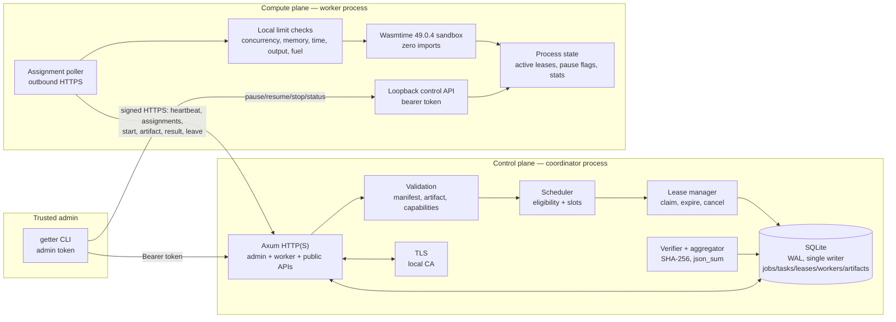
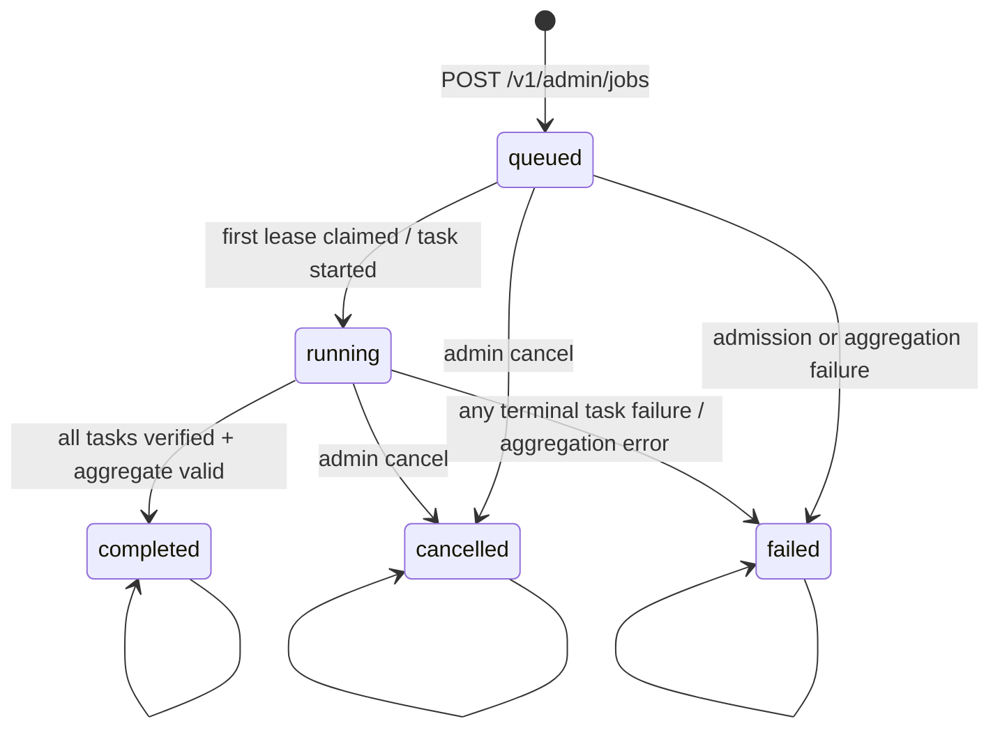
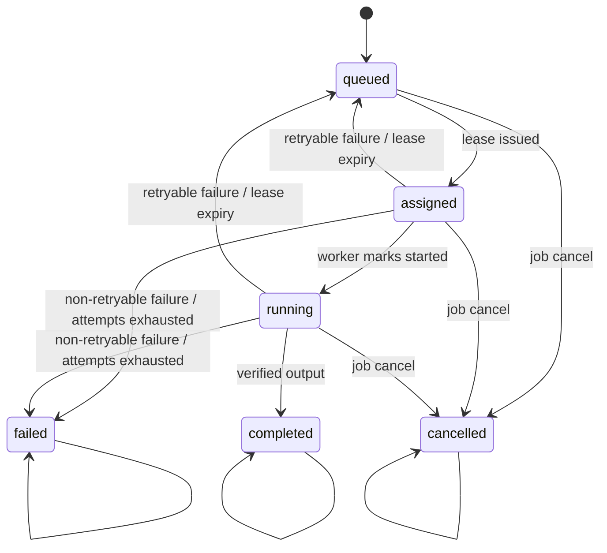

# Architecture

Getter is a coordinator/worker system for deterministic, independently
executable Wasm tasks. The coordinator owns trust, scheduling, durability, and
verification. Workers own execution and local resource enforcement. There is no
shared memory, no remote code loading outside signed assignments, and no host
capability exposed to guest code.

## Design goals

- **Local first.** One coordinator and one or more workers run on a loopback
  host, a LAN, or an isolated network without a cloud account or telemetry.
- **Explicit trust.** Enrollment is paired and one-time; workers sign requests;
  TLS uses a pinned local CA; discovery never grants authority.
- **Bounded execution.** Task count, module size, input, output, memory, fuel,
  wall-clock time, concurrency, and download size are limited by the
  coordinator, the worker, or both.
- **Durable recovery.** Jobs, tasks, leases, workers, and artifacts are persisted
  in SQLite so a coordinator restart can recover leasing state.
- **Verifiable outputs.** The coordinator validates each output against a
  trusted reference digest and computes aggregation itself; workload code never
  runs in the coordinator.
- **Boring operations.** A single binary, a single local state directory, a
  single-writer database, and foreground services suitable for systemd.

## Non-goals in 0.1.0

Exactly-once execution, Byzantine result honesty, coordinator high availability,
federation, peer-to-peer artifact transfer, WASI or host imports, idle-user
detection, precise bandwidth shaping, remote attestation, and online CA
rotation are not implemented. See [Limitations](limitations.md).

## Control plane and compute plane



The **control plane** is the coordinator: authentication, admission control,
scheduling, lease issuance, result verification, aggregation, persistence, and
discovery. The **compute plane** is the worker: artifact download, sandbox
execution, cancellation, and result submission. The worker always initiates
coordinator connections; it never listens for coordinator traffic. Its only
listener is a loopback control API for the local CLI.

Artifacts travel over the same HTTP(S) service from the coordinator to the worker
under a short-lived lease. There is no P2P transfer in `0.1.0`; the
lease-authorized artifact endpoint is the boundary where a future transfer
mechanism would plug in.

## Workspace and crate boundaries

| Crate | Package | Responsibility |
| --- | --- | --- |
| `crates/getter-protocol` | `getter-protocol` | Transport-neutral wire types, constants, HTTP paths and headers, discovery messages, validation limits, state enums |
| `crates/getter-core` | `getter-core` | Config schema/validation, local state provisioning and permissions, auth primitives, signature canonicalization, per-worker replay/rate guard, scheduler eligibility, state-transition rules, job/output/artifact validation, aggregation |
| `crates/getter-storage` | `getter-storage` | SQLite connection, WAL setup, forward-only migrations, worker enrollment, pairing tokens, job/task/lease transactions, persistent cancellation notifications, result acceptance, statistics |
| `crates/getter-runtime` | `getter-runtime` | Wasmtime engine, capability-free store, fuel/epoch/memory/output enforcement, ABI exports, artifact validation |
| `crates/getter-coordinator` | `getter-coordinator` | Axum HTTP/TLS server, admin/worker/public middleware, handlers, background lease/stale-worker sweeps, UDP discovery announcer |
| `crates/getter-worker` | `getter-worker` | Outbound signed client, polling/heartbeat loops, local pause and battery policy, control API, task execution and retry submission |
| `crates/getter-cli` | `getter-cli` (binary `getter`) | Command surface, init/pair/join, admin and control clients, diagnostics, job file loading, human/JSON output |
| `crates/getter-workload-sdk` | `getter-workload-sdk` | Guest-side ABI macro and allocation/packing helpers; no third-party dependencies |
| `examples/sum-squares` | excluded from the workspace | Standalone guest crate and reference workload |

Dependency direction is intentionally one-way:

```text
getter-protocol
   ↑        ↑          ↑
getter-core │          │
   ↑        │          │
getter-storage        │
   ↑        │          │
getter-coordinator    │
   ↑                   │
getter-cli → getter-worker → getter-runtime
                              ↑
                     getter-protocol
```

`getter-cli` depends on the coordinator and worker libraries for local
operations. The coordinator never depends on the worker or runtime. Workloads
depend only on the SDK and compile separately for `wasm32-unknown-unknown`.

## Job lifecycle



Task lifecycle:



The state guards are in `getter-core::states`; persistence and transitions are
enforced inside SQLite immediate transactions in `getter-storage`.

A job is `completed` only when every task is completed, every output passes the
job's verification policy, aggregation succeeds, and any expected aggregate
matches. If an expected aggregate is present but differs, the job is failed with
an explicit error even though all tasks individually completed. `failed` is
terminal; there is no retry-whole-job operation in `0.1.0`.

## Scheduling and leases

1. The coordinator validates the manifest, artifact bytes, digest, and worker
   capabilities.
2. The CLI uploads the artifact base64-encoded inside a `JobSubmission`; the
   coordinator stores the artifact as a BLOB keyed by SHA-256 and persists tasks.
3. A worker polls `GET /v1/worker/assignments?max=N` with a signed request and
   advertises availability through heartbeats.
4. Inside one `BEGIN IMMEDIATE` transaction, the coordinator selects queued
   tasks in `(job.created_at, task.seq)` order that fit the worker's advertised
   slots and limits, issues a lease with a random lease token, marks tasks
   `assigned`, and returns assignments.
5. The worker downloads the artifact under the lease token, checks its SHA-256,
   marks the task started, executes it with per-task limits intersected with the
   worker's local maxima, and submits the result.
6. The coordinator validates the lease token, recomputes the output hash,
   applies the verification policy, persists the output, and finalizes the job
   when no tasks remain active.
7. A background sweep expires leases once per second. Expired work is requeued
   while attempts remain, otherwise failed. Cancellation revokes active leases,
   records persistent cancellation notifications, and communicates them on the
   next heartbeat.
8. If a worker cannot execute for an infrastructure reason (pause, shutdown,
   local cancellation, no CPU slot, artifact download failure, or insufficient
   lease time), it submits an explicit requeue. The coordinator
   marks the lease abandoned, returns the task to the queue, and decrements the
   attempt counter so a workload retry is not consumed. More than 32 abandoned
   leases for one task fails it.

There is **no lease extension protocol** in `0.1.0`. A job's `lease_seconds`
must exceed each task's timeout by at least five seconds. Workers also stop
executing `lease_safety_secs` before lease expiry. If a task cannot finish in
the remaining lease, the worker reports a retryable failure rather than
overrunning the lease.

This is **at-least-once** execution. A worker crash, coordinator crash, network
partition, pause, cancellation, or result-delivery failure can cause a task to be
re-executed. Output acceptance and aggregation are deterministic, but arbitrary
external side effects in a workload are not exactly-once.

## Persistence

The coordinator opens one SQLite database at
`<home>/data/getter.db` (path configurable). On Unix it is chmod `0600`; the
parent directory is created by the store if needed. The store:

- enables foreign keys and a 5-second busy timeout;
- uses WAL journaling where supported and `synchronous=NORMAL`;
- guards one `rusqlite::Connection` with a process mutex;
- applies forward-only migrations in a transaction and records versions;
- the current schema version is 3. Migration 1 creates `workers`,
  `pairing_tokens`, `artifacts`, `jobs`, `tasks`, and `leases`; migration 2 adds
  persistent `cancellation_notifications`; migration 3 adds
  `jobs.workload_name`. Indexes cover state/queue/expiry and pending
  cancellations.

All store calls are synchronous; request handlers run them behind the process
mutex rather than in a separate blocking pool. There is no replication,
multi-coordinator consensus, or coordinator failover. Back up the state directory
as described in [Operations](operations.md).

## Verification and aggregation

- The coordinator checks `workload.sha256` against the uploaded artifact before
  storing it.
- The worker independently checks the downloaded artifact's SHA-256 against the
  assignment.
- The runtime checks Wasm magic, required exports, zero imports, and limits. A
  worker may cache compiled modules by artifact digest; the first compilation of
  a new module is not covered by fuel or the guest wall-clock deadline.
- The coordinator recomputes SHA-256 over the exact output bytes it receives; a
  worker-declared digest is only a consistency check on transport.
- `exact_sha256` requires every task to carry `expected_output_sha256` and
  rejects a mismatch. `trusted` is an explicit coordinator opt-in and labels
  results unverified.
- `none` aggregation returns task keys, hashes, and base64 bytes.
  `json_sum` parses each output as JSON, reads one unsigned integer/decimal
  string field, and sums with checked `u128` arithmetic. The coordinator never
  executes task code.
- An optional `expected_aggregate` is compared as exact JSON.

Checksums are only as trustworthy as the job author's reference values. They are
not a fraud proof or a substitute for independent replication. See
[Security](security.md).

## Resource enforcement layers

| Layer | Enforces |
| --- | --- |
| Coordinator admission | Protocol/job format, ABI identifier, task count, max attempts, lease range, input size, declared output-limit total, artifact size/digest, required trusted hashes, aggregation shape, expected-aggregate size |
| Scheduler | Worker ABI support, active participation, CPU slots, memory/time/output/fuel maxima |
| Worker pre-flight | ABI identifier, input size, requirements versus local maxima, lease time remaining, pause/shutdown state |
| Worker download | Configurable artifact download ceiling; digest check before execution |
| Runtime | Module size/magic, zero imports, required exports, memory/table/instance limits, fuel, epoch deadline, output length/bounds |
| Coordinator result | Body/result size, base64 validity, recomputed output SHA-256, verification policy, output limit, lease ownership/expiry |
| Aggregation | JSON shape, unsigned integer/decimal field, checked `u128` sum, optional expected match |

A job can be admitted even if no currently connected worker is large enough to
run it; it will remain queued. There is no admission check against the live
worker set, and no resource reservation across workers. A worker's per-task
memory ceiling is also not a worker-wide cap: concurrent tasks can aggregate to
roughly `concurrency × max_task_memory_bytes` plus host overhead.

## Security boundaries

1. **Admin → coordinator:** trusted operator, bearer token, TLS on LAN.
2. **Pairing human → coordinator/worker:** out-of-band token and CA fingerprint,
   one-time enrollment.
3. **Worker → coordinator:** Ed25519 request signatures over method, path/query,
   timestamp, nonce, and body hash, inside TLS.
4. **Coordinator → worker task data:** lease token authorizes artifact download;
   lease token also authenticates start and result.
5. **Worker → guest Wasm:** no imports, no WASI, bounded memory/CPU/time/output.
6. **Local CLI → worker control:** loopback plus a per-worker bearer token. This
   is not server authentication; any same-OS-user process that reads the token
   can control the worker.
7. **LAN discovery → user:** unauthenticated, informational only, no automatic
   trust.
8. **Local OS → state:** Unix `0700` directories and `0600` files; same-user and
   root access remain outside the boundary.

Detailed threats, mitigations, and non-guarantees are in
[Security](security.md) and the [threat model](threat-model.md).

## Failure behavior

| Failure | Behavior |
| --- | --- |
| Worker process dies | Heartbeats stop; after heartbeat timeout it is shown offline. Its active leases expire and tasks are requeued if attempts remain. |
| Worker loses network | Heartbeats/results fail and retry; coordinator may requeue after lease expiry. The worker may still be executing a task whose result will later be rejected as stale. |
| Coordinator process dies | Workers keep polling/heartbeating and retry; durable jobs/tasks/leases survive. After restart, leases continue to be active until expiry; in-flight results can still be accepted while the lease is valid. |
| Result submission is duplicated | The coordinator accepts an identical completed output idempotently (`duplicate: true`); a conflicting or stale result is not accepted as success. |
| Worker is paused | Polling stops and running tasks are cancelled immediately; the worker submits infrastructure requeues. The coordinator requeues them without consuming a workload attempt, bounded by 32 abandoned leases per task. |
| Coordinator cancels a job | Tasks and leases are marked cancelled, persistent cancellation notifications are recorded, and workers learn about them on their next heartbeat and abort local execution. |
| Task is retried after a partial success | At-least-once semantics apply; workloads must be deterministic and side-effect-safe or tolerate duplicate execution. |

## Extension points (not implemented)

- **P2P artifact transfer:** replace the coordinator artifact fetch behind the
  lease-authorized boundary while preserving digest checks and lease validity.
- **Federation / multiple coordinators:** would require authenticated
  coordinator identity, result reconciliation, and a shared trust model; none
  exists.
- **Remote attestation / signed worker measurements:** could strengthen result
  honesty beyond trusted reference hashes.
- **Additional ABI versions:** the runtime is built for exactly
  `getter.abi.v1`; a new ABI is a deliberate protocol and SDK change.
- **WASI:** intentionally absent. Adding host imports would break the zero-import
  sandbox contract.

These are design directions, not shipped features. Do not rely on them.
