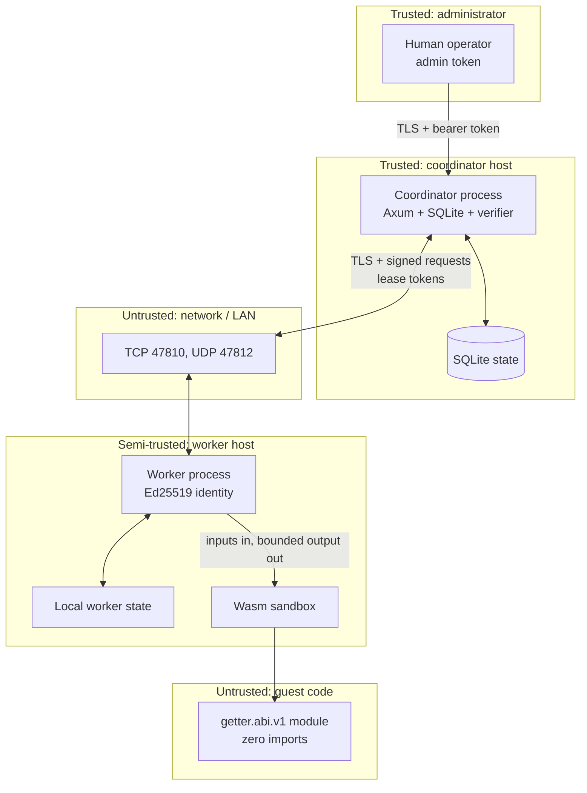

# Security overview

This document maps Getter's trust boundaries and the abuse cases considered in
`0.1.0`. An independent pre-release security review was completed and
critical/high findings were addressed. This is not an external third-party audit
and no audit report is claimed. The detailed, standalone threat model is
[threat-model.md](threat-model.md); reporting and scope are in
[SECURITY.md](../SECURITY.md). Limitations that affect these claims are
collected in [Limitations](limitations.md).

## Guiding assumptions

- The coordinator host and the administrator are trusted.
- The network between coordinator and workers is untrusted unless it is a
  loopback or an isolated link; TLS and request signing are still required.
- A worker host is semi-trusted. It may be compromised, buggy, or operated by a
  cooperative but curious party. It sees the inputs/outputs it computes.
- Workload code is untrusted. It must not receive filesystem, network, clock,
  randomness, environment, arguments, or host function imports from Getter.
- The job author's `expected_output_sha256` values are trusted reference data. A
  malicious admin can make a job that validates malicious output; that is an
  admin compromise, not a checksum bypass.
- Local OS users other than the Getter service user are outside the boundary;
  root and same-user processes can read the home.
- Wasmtime, Rust, the OS, and the dependency supply chain are trusted to behave
  correctly for the sandbox to hold.

## Assets

| Asset | Location | Sensitivity |
| --- | --- | --- |
| Admin bearer token | coordinator `<home>/secrets/admin-token` | Grants full control of coordinator state/jobs |
| Worker Ed25519 private key | worker `<home>/worker/identity.json` | Impersonates the worker to the coordinator |
| Worker control token | worker `<home>/secrets/control-token` | Pauses/resumes/stops the local worker via loopback |
| Pairing token | printed by `getter pair`; transient | Enrolls one named worker once; short-lived |
| Lease tokens | assignment JSON, memory | Authorizes start/result/artifact for one lease |
| TLS server private key | coordinator `<home>/tls/server-key.pem` | Impersonates the coordinator if its CA is trusted |
| Local CA certificate | coordinator `<home>/tls/ca.pem`, worker trust copy | Pins coordinator identity; public but security-critical |
| Coordinator database | `<home>/data/getter.db` | Job inputs/outputs, worker metadata, hashes, history |
| Job inputs/outputs | coordinator DB; worker memory | May contain confidential user data |
| Source/artifacts | repository, coordinator `artifacts` table | Integrity of executed code |

The CA private key is discarded after `init` generates the server certificate.
The retained server key can impersonate the coordinator while workers trust that
CA; protect it. There is no online CA rotation in `0.1.0`.

## Trust boundaries

| # | Boundary | Authentication / authorization | What it protects |
| --- | --- | --- | --- |
| B1 | Administrator → coordinator | Bearer admin token, TLS for LAN; constant-time token compare | Job submission, pairing, worker revocation, inspection, cancellation, status, contribution |
| B2 | Worker → coordinator | Ed25519 signature over worker ID, method, path/query, timestamp, nonce, body hash; TLS server auth + pinned CA | Heartbeats, assignment polling, start, artifact fetch, results, leave |
| B3 | Pairing human → coordinator/worker | One-time, name-scoped token; CA certificate or out-of-band SHA-256 fingerprint | Initial worker authorization and trust bootstrap |
| B4 | Coordinator → worker task data | Lease token (hash-at-rest) bound to worker/lease/expiry; assignment returned only to the assigned worker | Artifact bytes, task start, result acceptance |
| B5 | Worker → guest Wasm | Capability-free Wasmtime store, zero imports, fresh instance, limits | Host filesystem/network/memory/CPU from guest code |
| B6 | LAN discovery → user | None; datagrams are unauthenticated and grant no authority | Discovery convenience only; no auto-enrollment |
| B7 | Local OS → Getter home | Unix `0700`/`0600`, symlink rejection for identity/token reads | Cross-user reads; not same-user, root, or host compromise |
| B8 | Job author → verification | Trusted `expected_output_sha256` values and coordinator-side comparison | Output integrity relative to the reference |

A worker's TLS connection authenticates the **server**, not the worker with a
client certificate. The application-level Ed25519 signature is the worker
authentication. An attacker who steals a worker key can impersonate that worker
until it is revoked, but cannot forge results for a different worker ID or use
another worker's lease.

## Threats and mitigations

### Administrator and enrollment

| Threat | Mitigation | Residual risk |
| --- | --- | --- |
| Stolen admin token | Token is `0600`, never printed/logged, constant-time compared; operator can revoke/re-enroll workers via API; rotate by reinit | No token-rotation CLI, no per-scope tokens, and no admin rate limiting; a stolen token is full control |
| Brute-force pairing token | 32 random bytes, `getter_pair_` prefix, SHA-256 hash at rest, one-time, name-scoped, TTL 60–86400 s | Online guessing remains theoretically possible; no attempt-rate limiter |
| Pairing token reuse | Consumed atomically with worker creation; name must match; unused token expires | No early per-token revocation CLI; an unused token is valid until expiry |
| Rogue worker enrolls | Must know a valid token and matching name; worker public key uniqueness; coordinator rejects malformed capabilities | An attacker who obtains a token can enroll one worker under that name |
| MITM during CA bootstrap | Fingerprint is supplied out of band; unverified bootstrap fetches only the public CA; no pairing token is sent on it; mismatch aborts; CA files must contain exactly one certificate (bundles are rejected) | If the user accepts a fingerprint from the attacker/discovery, trust is broken |
| Worker/coordinator name spoofing | TLS server name/SAN checks; CA pinning; worker IDs and names bound at enrollment | Names are display labels; uniqueness is enforced in the DB, not a global identity |

### Worker API

| Threat | Mitigation | Residual risk |
| --- | --- | --- |
| Forged worker request | Ed25519 signature covers worker ID, method, exact path/query, Unix timestamp, nonce, SHA-256 of body; verifying key from enrolled worker | Stolen private key = valid signer until revocation |
| Worker requeues repeatedly | Infrastructure requeue does not consume a workload attempt, but is capped at 32 abandoned leases per task; a requeue that would exceed the cap fails the task | A malicious or pathological worker can delay a task up to that bound; there is no per-worker reputation/fair-share |
| Replayed signed request | ±90 s timestamp window; per-worker nonce TTL (180 s); bounded per-worker guard with a 76,800 requests/60 s ceiling, 262,144 nonces/worker, and 100,000 tracked workers; 401 is an auth failure, while 429/503 are transient throttling/capacity and must not de-authorize a worker; body re-read and signature checked before handler | **Process-local guard.** Restart clears replay state and rate counters; a captured request can be replayed within the window if still useful. Limits are not configurable |
| Clock manipulation | ±90 s window; UTC timestamps | A host with a wildly wrong clock fails closed with 401; no secure time source inside Getter |
| Cross-worker lease use | Lease token hash bound to worker ID, lease, task; constant-time comparison; result/start/artifact validate ownership and expiry | A compromised worker with its own lease can only affect its own assignment |
| Stale result accepted | Lease must be active and unexpired at acceptance; cancelled jobs rejected; task state must be assigned/running | Race between expiry and result acceptance is resolved inside one immediate transaction |
| Duplicate result | Same completed output is acknowledged idempotently; conflicting output is not accepted as success | At-least-once execution can repeat external side effects |
| Revoked worker keeps working | Revocation marks worker revoked/offline, expires active leases, rejects signed requests | A disconnected worker may keep executing locally; its result will be rejected when it reconnects |

### Job admission and storage

| Threat | Mitigation | Residual risk |
| --- | --- | --- |
| Oversized/hostile job | Protocol identifier, ABI, task count, input sizes, total input, declared output-limit total, max attempts, lease range, artifact size/digest, expected-aggregate size, HTTP body limit | A valid admin can still fill disk with accepted jobs; no retention/GC |
| Artifact substitution | SHA-256 checked at CLI upload, coordinator admission, and worker download; artifact stored by digest | A malicious admin/job author can submit any Wasm; checksum only proves it matches the manifest |
| Malformed Wasm | Runtime checks magic, required exports, zero imports, size, and limits before execution | Compilation can consume CPU before the guest timeout; Wasmtime bugs are in scope of the sandbox risk |
| SQL injection | Parameterized `rusqlite` queries; typed deserialization; no dynamic SQL from user strings | Dependency/DB engine bugs; local DB file tampering is outside the boundary |
| DB disclosure/tampering | `0600` DB, `0700` home, no network DB listener; backups protected | No at-rest encryption; root/compromised host sees everything; no signature over DB rows |
| Path traversal | No user-supplied filesystem paths are used by the coordinator for artifacts; job `workload.artifact` is resolved only by the local CLI; home paths are operator-supplied | Local CLI path handling is a user-controlled filesystem operation by design |
| Symlink/secret read | Worker identity/token reads reject symlinks and enforce regular files + mode on Unix; atomic `0600` writes | Windows mode checks are not applicable; same-user attacker can read anyway |
| HTTP body abuse | Global 48 MiB default body limit; 64 KiB enrollment body limit; endpoint-specific result/artifact caps; bounded JSON decoding; per-worker signed-request throttling | No admin/public or connection-level rate limiting; a flood can still consume CPU/bandwidth |

### Verification and aggregation

| Threat | Mitigation | Residual risk |
| --- | --- | --- |
| Wrong worker output | Coordinator recomputes SHA-256 over received bytes and compares `expected_output_sha256`; output size checked first | Reference hash comes from the job author; a wrong reference validates wrong output. No replication/fraud proof. `trusted` mode is unverified |
| Worker lies about its digest | Declared digest is checked against received bytes as a transport consistency check, then the coordinator recomputes it; acceptance does not trust the declaration | A lying worker cannot make a different output match the trusted hash unless it finds a preimage |
| Aggregation tampering | Coordinator parses JSON, enforces unsigned integer/decimal string, checked `u128` sum; workload code never runs in coordinator | Very large sums overflow and fail; `expected_aggregate` is exact JSON comparison |
| Output preview/log injection | Previews are bounded, reject invalid UTF-8, and replace control characters; logs do not include full outputs | User-controlled job names/input are validated for control characters in some fields; operators should still treat logs as untrusted text |
| Job cancellation race | Cancel transaction marks tasks/leases cancelled, sets `cancel_requested`, and persists cancellation notifications; result acceptance rejects cancelled jobs; heartbeats deliver notifications | A result already accepted just before cancel remains completed; job becomes cancelled with completed task rows, which is visible. A worker that never acknowledges can receive the same notification repeatedly |

### Guest sandbox

| Threat | Mitigation | Residual risk |
| --- | --- | --- |
| Guest reads host files/network | No WASI, no imports, no preopened dirs, no sockets, no env/argv; only linear memory and the ABI calls | A Wasmtime escape or misconfiguration could violate this. **Sandboxing is not a proof.** |
| Guest exhausts CPU | Fuel metering plus wall-clock epoch deadline; cancellation flag checked on epoch callbacks; max fuel/timeout | Compilation time is outside the guest timeout; fuel accounting and scheduling introduce overhead/approximation |
| Guest exhausts memory | Store memory limit, bounded memories/instances/tables, trap-on-grow-failure; per-task memory requirement | It is a Wasm linear-memory limit, not an OS RSS/cgroup quota; host allocations for compilation/output exist |
| Guest returns huge/invalid output | Output length checked against requirement before reading; checked pointer+length bounds; output copied only inside memory | A guest can return a pointer to data written by itself; that is expected. The host does not validate content beyond policy |
| Guest hangs/traps | Epoch deadline + fuel + cancellation; trap classified as failure | A non-yielding host call cannot occur because there are no imports; a long compile can still block a worker thread |
| Guest forges ABI behavior | ABI checks exports and zero imports; fresh instance per execution; SDK leaks allocations | The ABI FFI boundary is unsafe by nature; a malicious guest can return arbitrary bytes within limits |
| Multiple tasks share state | Host uses a fresh `Store`/instance per `execute`; no shared guest memory between tasks | Worker process and Wasmtime engine are shared; engine-level bugs/caches are in the sandbox trust base |

### Discovery and network

| Threat | Mitigation | Residual risk |
| --- | --- | --- |
| Fake coordinator announcement | Discovery grants no trust; enrollment still requires a one-time token and CA fingerprint from `pair`; no auto-trust | A user who treats discovery output as authoritative can be misdirected |
| Credential leakage via discovery | Announcements contain name, URL, CA fingerprint, protocol/version, timestamp; no tokens or keys | Metadata exposure (topology, versions) on the LAN |
| Eavesdropping | TLS for coordinator traffic, including worker requests; loopback for control | TLS is not used on the worker control API because it is loopback-only; local packet capture by the same user is outside the boundary |
| Network DoS | Bounded bodies, timeouts, connection handling by Axum, per-worker signed-request guard; firewall guidance | No admin/public rate limiting, SYN-flood protection, or DDoS mitigation; no coordinator HA |
| Wrong public URL | Config validation requires URL/scheme consistency; pair returns `public_url`; operators must make it reachable | Misconfiguration can expose a different service or break enrollment; no automatic discovery of the correct URL |

### Host and supply chain

| Threat | Mitigation | Residual risk |
| --- | --- | --- |
| Malicious/compromised dependency | Lockfile, pinned Rust 1.97 toolchain, Wasmtime 49.0.4 with current advisory fixes, minimal features, read-only CI dependency audit (`cargo audit`; zero known vulnerabilities, one unmaintained-package warning at the time of writing) | No `cargo-deny` policy, reproducible builds, SBOM, or secret scanning yet; upstream compromise is possible |
| Compromised coordinator host | Trust boundary; file permissions; backup | Full state/admin access; no remote attestation or HSM |
| Compromised worker host | Revocation; lease output verification; per-worker identity | Can read assigned inputs, refuse work, or return wrong outputs that should fail hashes; can consume resources within limits |
| Same-user local attacker | None; same-user can read `0600` files | Expected OS boundary; use a dedicated account and host hardening |
| Malicious release artifact | Future signing/checksums; no verified release exists yet | No signed release; users must build from reviewed source |

## Abuse cases explicitly considered

- An unauthenticated LAN host sends discovery packets or enrollment attempts: no
  authority, tokens required, invalid tokens rejected, no auto-trust.
- An enrolled worker submits fabricated results: lease and signature checked,
  output hash verified, aggregation deterministic; wrong outputs fail unless the
  reference is wrong.
- An enrolled worker replays its own captured request: the per-worker replay
  guard and clock window reject within the process lifetime; restart risk is
  documented. A noisy worker is throttled without starving other workers'
  nonce namespaces.
- A worker steals another worker's lease ID/token: worker ID and token hash are
  bound; rejected.
- A worker keeps running after cancellation: coordinator marks cancelled and
  sends cancel leases on heartbeat; result is rejected. The worker might waste
  local CPU until it notices.
- A guest tries to import WASI or any host function: module import count is
  checked and rejected before execution.
- A guest returns an out-of-bounds pointer/length: checked and rejected.
- A guest produces a 4 GiB output by lying: output length is bounded before
  copying.
- A job declares more than the total output ceiling: rejected at admission.
- A malicious admin submits arbitrary Wasm: in scope of admin trust; sandbox
  still limits host access.
- A compromised worker host reads its assigned task data: by design; it must
  execute it. Do not schedule secrets to untrusted workers.
- An attacker floods the coordinator: size/execution limits and a per-worker
  signed-request throttle help, but there is no admin/public or connection-level
  rate limiter; use network controls.

## Non-guarantees

Getter does **not** provide:

- proof that Wasm sandboxing cannot be broken;
- general computation honesty, independent replication, or fraud proofs;
- exactly-once execution or exactly-once external side effects;
- confidentiality from the coordinator or the assigned worker;
- at-rest encryption, secure erase, or tamper-evident audit logs;
- coordinator high availability or Byzantine fault tolerance;
- worker binary attestation, measured boot, or hardware-rooted identity;
- protection from a compromised host, root, or the same OS user;
- authenticated LAN discovery;
- coverage of new-module compilation by fuel or the guest timeout;
- a durable replay/rate state across coordinator restarts;
- server authentication on the loopback worker control API (its bearer token is
  not a server credential);
- idempotent enrollment or claim responses at the transport layer;
- worker-wide memory admission or cgroups (per-task limits aggregate across
  concurrency);
- non-blocking/asynchronous SQLite access (store calls are synchronous behind a
  process mutex);
- bandwidth shaping;
- physical-LAN validation or an external third-party audit.

## Recommended deployments

1. **Single host / evaluation:** loopback, TLS on, one coordinator and one or two
   worker homes, no LAN exposure. This is the intended primary topology.
2. **Trusted lab LAN:** private network, firewall TCP 47810 to known hosts, TLS
   with fingerprint pinning, clocks synchronized, admin operations from a
   trusted host, backups protected. This is documented but unverified on
   physical hardware here.
3. **Do not** expose the coordinator directly to the public internet in
   `0.1.0`; there is no admin/public rate limiting, WAF, per-job ACL, or audit
   trail. If remote access is unavoidable, put it behind a hardened private
   overlay/VPN and restrict the admin token to a management path.

## Future work

Durable/distributed replay protection, compile-time resource limits, independent
result replication, remote attestation, rate limits, per-job authorization, TLS
client certificates, CA rotation, at-rest encryption, an external audit report,
and signed releases. These are plans, not current properties. See
[Limitations](limitations.md) and the [threat model](threat-model.md).
