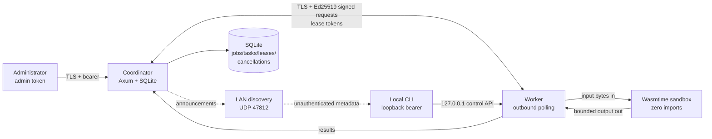

# Threat model

This is the standalone threat model for Getter `0.1.0`. It is an engineering
analysis, not a certification. An independent pre-release security review was
completed and critical/high findings were addressed; that review is **not** an
external third-party audit, and no audit report is claimed. No signed release
exists.

Related documents: [Security](../SECURITY.md), [Security overview](security.md),
[Architecture](architecture.md), [Protocol](protocol.md), and
[Limitations](limitations.md).

## 1. Scope

In scope:

- coordinator HTTP(S) API, admin/worker/public authentication, enrollment, and
  discovery;
- worker daemon, local loopback control API, signed coordinator client, and
  pause/battery/nice behavior;
- Wasmtime execution sandbox and `getter.abi.v1` host/guest boundary;
- SQLite state, lease/retry/cancellation logic, result verification, and
  aggregation;
- CLI trust bootstrap, pairing, CA pinning, and local secret handling;
- source, dependency, CI, and release provenance to the extent Getter controls
  them.

Out of scope or assumed trusted:

- the administrator and admin token holder;
- the coordinator host OS, root, and physical access;
- a malicious process running as the same OS user as a Getter service;
- the Rust compiler, operating system, hardware, and Wasmtime correctness;
- upstream services (GitHub, registries) beyond how Getter uses them.

## 2. System model

The coordinator is the only scheduler and the only durable state owner. Workers
initiate all coordinator traffic. The worker's only listener is a loopback
control API used by the local CLI. Guest code has no imports, no WASI, no
filesystem, no network, no environment, and no arguments; the host supplies raw
input and reads a bounded output region.

Relevant limits:

- global request body default 48 MiB; public enrollment body 64 KiB;
- artifact ≤16 MiB, total declared inputs ≤16 MiB, per-result ≤1 MiB, total
  declared task output limits ≤64 MiB, per-task output ≤1 MiB;
- worker concurrency ≤128, per-task memory ≥1 MiB, per-task output ≤1 MiB;
- per-worker signed-request guard: 76,800 requests per 60 s, 262,144 nonces per
  worker, 100,000 tracked workers;
- infrastructure requeues: at most 32 abandoned leases per task.

## 3. Assets

| Asset | Where it lives | Why it matters |
| --- | --- | --- |
| Admin bearer token | coordinator `<home>/secrets/admin-token` (`0600`) | Full control of jobs, pairing, workers, status |
| Worker Ed25519 private key | worker `<home>/worker/identity.json` (`0600`) | Impersonates the worker |
| Worker control token | worker `<home>/secrets/control-token` (`0600`) | Local pause/resume/stop/status |
| Pairing token | output of `getter pair`; transient | One-time enrollment of one named worker |
| Lease tokens | assignment JSON; hashed at rest | Artifact/start/result authorization for one lease |
| Coordinator TLS key | `<home>/tls/server-key.pem` (`0600`) | Server impersonation while its CA is trusted |
| CA certificate and fingerprint | coordinator/worker TLS trust state | Pins the coordinator identity |
| Job inputs/outputs | coordinator SQLite; worker memory | May contain sensitive data |
| Worker/task state and cancellation notifications | coordinator SQLite | Integrity of scheduling and recovery |
| Source, Wasm artifact, release provenance | repository, coordinator BLOB store | What code actually runs |

The CA private key is discarded after `init` generates the server certificate;
the retained server private key still impersonates the coordinator to workers
that trust that CA. There is no online CA rotation.

## 4. Trust boundaries

| # | Boundary | Authentication/authorization | Security consequence |
| --- | --- | --- | --- |
| B1 | Administrator → coordinator | Bearer admin token, constant-time compare, TLS on LAN | Admin token compromise is full control; no per-scope tokens or admin rate limit |
| B2 | Worker → coordinator | Ed25519 signature over worker ID, method, exact path/query, Unix timestamp, nonce, body SHA-256; TLS server auth + pinned CA | Application-level worker identity; stolen key = impersonation until revoke |
| B3 | Human pairing → coordinator/worker | One-time name-scoped token; CA cert/fingerprint from a trusted channel | Pairing bootstrap is the trust root; lost response consumes the token |
| B4 | Coordinator → worker task data | Hashed lease token bound to worker/lease/task/expiry; assignment only to assigned worker | Cross-worker lease use rejected; compromised worker sees its assigned inputs |
| B5 | Worker → guest Wasm | Capability-free Wasmtime, zero imports, fresh store/instance, memory/fuel/epoch/output limits | Wasmtime/embedding bugs are the residual escape risk |
| B6 | Local CLI → worker control | Loopback bind, independent `0600` bearer token | **Not server authentication**; same-user processes can read the token |
| B7 | LAN discovery → user | None; unauthenticated UDP | Informational only; no auto-trust or enrollment |
| B8 | Job author → verification | Trusted `expected_output_sha256`; coordinator recomputes digests and aggregates | Reference-data correctness, not general honesty |
| B9 | Source → release | Lockfile, pinned toolchain, CI, provenance attestation, future signing | No signed release or external audit yet |

TLS authenticates the coordinator server to workers; there are **no TLS client
certificates**. Worker authentication is the Ed25519 request signature. A CA
trust file must contain exactly one certificate; multi-certificate bundles are
rejected rather than silently trusting the first certificate.

## 5. Attacker capabilities

Considered:

- an unauthenticated host on the LAN, able to send UDP discovery packets and TCP
  requests, replay captured traffic, and advertise a fake coordinator;
- a malicious or compromised enrolled worker, able to sign requests, submit
  arbitrary results/requeues, and refuse or delay work within its lease;
- a malicious workload author/admin, able to submit arbitrary Wasm and trusted
  hashes (admin trust means this is not a sandbox escape by itself);
- a network attacker who can observe/modify traffic but not break TLS;
- a local unprivileged user on a worker/coordinator host, including one who can
  read the same user's `0600` files;
- a supply-chain attacker in a dependency or release path.

Not considered in the security guarantee: root/administrator on the host,
physical extraction of keys, hardware faults, side-channel extraction from the
CPU/Wasmtime, or a compromised Rust/Wasmtime toolchain.

## 6. Threats and controls

### 6.1 Administrator and coordinator

| Threat | Controls | Residual risk |
| --- | --- | --- |
| Stolen/leaked admin token | Token `0600`, never printed by CLI, constant-time compare, TLS on LAN, revoke/re-enroll workers via admin API | No per-scope tokens, rotation CLI, or admin rate limiting; token holder is fully trusted |
| Unauthenticated admin request | Bearer token required on `/v1/admin/*`; 401 otherwise | Online token guessing is not rate-limited |
| Admin endpoint DoS | 48 MiB global body cap; bounded JSON; job/task/output limits | No admin rate limit, WAF, or HA |
| Coordinator host compromise | Trust boundary; no secrets in logs; file modes | Full state and admin access; no HSM/attestation |
| Misconfigured public URL/TLS | Scheme validation; non-loopback plaintext refused by default; `doctor` | Wrong reachable address can break enrollment or expose another service |

### 6.2 Pairing and TLS bootstrap

| Threat | Controls | Residual risk |
| --- | --- | --- |
| Pairing-token theft or reuse | 32 random bytes, `getter_pair_` prefix, SHA-256 at rest, one-time, name-scoped, TTL 60–86400 s; 64 KiB enrollment body | An attacker who obtains a token can enroll one worker under that name; no pairing attempt rate limit |
| MITM during CA fetch | Fingerprint from `pair`/out-of-band; unverified bootstrap fetches only the public CA; no pairing token sent on it; mismatch aborts; exactly-one-certificate parsing | If the operator accepts a fingerprint from discovery/attacker, trust is broken |
| Wrong or bundled CA | CA trust file must contain exactly one certificate; multi-cert bundles rejected | No online rotation; replacing the CA requires re-enrollment |
| Enrollment response loss | Token is consumed atomically with worker creation | Retry is rejected; operator must create a new token. Enrollment is not transport-idempotent |
| Rogue worker enrollment | Token/name/public-key constraints; unique name/key; capability validation | One valid token can enroll one worker under that name |

### 6.3 Worker authentication, replay, and rate

| Threat | Controls | Residual risk |
| --- | --- | --- |
| Forged worker request | Ed25519 signature over worker ID, method, exact path/query, Unix seconds, nonce, body hash; key from enrollment | Stolen private key = valid signer until revoked |
| Replay | ±90 s clock window; 180 s nonce TTL; 262,144 nonces/worker; 76,800 requests/60 s/worker | **Process-local**: restart clears replay/rate state; captured traffic may replay within the window if still useful |
| Nonce-cache exhaustion / noisy worker | Per-worker nonce and rate namespaces; 100,000 tracked workers; 429 for rate, 503 for capacity | 429/503 are transient, not deauthorization; no global/admin rate limit |
| Clock manipulation | 90-second window; UTC timestamps | Wildly wrong clocks fail with 401; no secure time source inside Getter |
| Cross-worker lease use | Lease hash bound to worker/lease/task; constant-time compare; owner/expiry checks on start/result/artifact | Stolen worker key can act within its own assignments |
| Revoked worker | Revocation marks revoked/offline, expires active leases, rejects signed requests | A disconnected worker may keep executing; result is rejected on return |

### 6.4 Leases, retries, and cancellation

| Threat | Controls | Residual risk |
| --- | --- | --- |
| Duplicate execution | At-least-once leases; duplicate completed output accepted idempotently; conflicting bytes not accepted as success | External side effects can repeat; not exactly-once |
| Stale result | Lease must be active/unexpired; cancelled jobs rejected; task state must be assigned/running; one immediate transaction | Race at expiry is resolved by state, not wall-clock agreement |
| Worker crash / network loss | Heartbeats go stale; lease expiry sweep requeues while attempts remain; heartbeat timeout 20 s default | Delay up to heartbeat timeout + lease expiry; claim response loss delays recovery similarly |
| Worker pause/shutdown/local cancellation | `TaskOutcome::Requeue`; coordinator marks lease abandoned, requeues, decrements attempt; no workload retry consumed; 32 abandoned-lease cap | A malicious/chaotic worker can delay a task up to the cap; no per-worker reputation |
| Cancellation notification loss | Persistent `cancellation_notifications` table; heartbeat returns pending notifications; optional `acknowledged_cancellations` clears them | Unacknowledged notifications are redelivered; a disconnected worker may not learn until reconnect |
| Result submission loss | Worker retries up to three times with backoff; duplicate handling; lease expiry fallback | A lost final response can cause a later duplicate attempt; external effects repeat |
| Attempt exhaustion | `max_attempts` 1–10 for workload failures; lease expiry counts; 32-infra cap | No whole-job retry; operator resubmits |

### 6.5 Job admission and storage

| Threat | Controls | Residual risk |
| --- | --- | --- |
| Oversized/hostile job | Protocol/ABI validation; 1,000 task cap; 1 MiB/task input; 16 MiB total input; 64 MiB declared output total; 16 MiB artifact; max attempts/lease ranges; 64 KiB expected aggregate | A trusted admin can fill disk/job history; no retention/GC |
| Artifact substitution | SHA-256 at CLI upload, coordinator admission, worker download; stored by digest; runtime validates magic/exports/imports | A malicious admin can submit any Wasm; checksum only matches the manifest |
| Invalid/malicious Wasm | Zero-import check, required exports, module/input/output/memory/fuel/epoch limits, fresh instance | Compilation of a newly seen module is outside fuel/timeout bounds; Wasmtime bugs remain |
| SQL/DB injection | Parameterized queries; typed deserialization; no network DB listener | Dependency/engine bugs; local DB tampering is outside boundary |
| DB disclosure/tampering | `0600` DB/homes, backups protected, no remote DB | No at-rest encryption, secure erase, or row signatures |
| SQLite contention | Single writer mutex, immediate transactions, 5 s busy timeout, WAL | Synchronous DB work in handlers serializes; a slow disk or burst raises latency; no HA |
| Path/symlink | No coordinator user-supplied artifact paths; CLI resolves local paths; secret reads reject symlinks/regular-file violations on Unix | Windows ACLs/mode checks differ; same-user access remains |
| Body abuse | 48 MiB global cap; 64 KiB enrollment cap; result/artifact caps; bounded JSON decode | No admin/public/connection-level rate limit |

### 6.6 Guest sandbox and worker resources

| Threat | Controls | Residual risk |
| --- | --- | --- |
| Guest reads host files/network | No imports/WASI/preopens/sockets/env/argv; only ABI memory copy | **Sandboxing is not a proof.** A Wasmtime/embedding flaw could escape |
| Guest burns CPU | Fuel plus wall-clock epoch deadline; cancellation flag; fuel/timeout maxima | New-module compilation is not fuel/epoch-bounded; epoch resolution is ~10 ms plus scheduling |
| Guest exhausts memory | Store memory limit, memory/instance/table caps, trap-on-grow-failure; per-task memory requirement | Linear-memory cap is not OS RSS; host compilation/allocation exists; per-task limits aggregate over concurrency |
| Guest emits huge/invalid output | Output length checked before copy; checked pointer+length; per-task max 1 MiB | Content is arbitrary within limits; checksums decide acceptance |
| Guest hangs/traps | Epoch deadline, fuel, cooperative cancellation; trap classified | Compilation/CPU outside guest; no host imports to block on |
| Cross-task state | Fresh `Store`/instance per execution; compiled modules cached by digest | Worker process/Wasmtime engine are shared; engine bugs are in trust base |
| Malicious worker requeues | 32 abandoned-lease cap per task; results require lease token | Can delay a task up to the cap; no fair-share/reputation |
| Worker-wide memory pressure | Per-task memory limit | No worker-wide admission/cgroup; N concurrent tasks can aggregate N×M memory plus overhead |

### 6.7 Verification and aggregation

| Threat | Controls | Residual risk |
| --- | --- | --- |
| Wrong worker output | Coordinator recomputes SHA-256 over received bytes; exact reference hash; output size checked first | Reference comes from job author; no replication/fraud proof; `trusted` mode unverified |
| Worker lies about digest | Declared hash checked against bytes for transport; acceptance uses coordinator's own digest | Cannot forge a different output matching a trusted hash without a preimage |
| Aggregation tampering | Coordinator parses JSON, accepts unsigned integer/decimal string, sums with checked `u128`; workload code never runs in coordinator | Bad expected aggregate fails job; very large ranges overflow and fail |
| Cancellation/requeue race | State transitions and result acceptance in immediate transactions; cancelled jobs reject results; requeue has 32 cap | A result accepted just before cancel remains completed; job visible as cancelled |
| Admin-authored bad job | Admin is trusted; checksums only validate against supplied references | No independent verification of job author intent |

### 6.8 Local control and host

| Threat | Controls | Residual risk |
| --- | --- | --- |
| LAN access to worker control | `control_bind` must be loopback; token required | Not network exposed; no TLS on loopback |
| Same-user process controls worker | `0600` control token; loopback | **Loopback bearer is not server authentication.** Same-user can read token and pause/stop worker |
| Secret file read by other OS users | `0700` homes, `0600` files, symlink/regular-file checks on Unix | Root, same user, compromised host; Windows ACLs differ/not verified |
| Local state loss | SQLite durable local file; backups documented | No replication/HA; lost/corrupt home loses jobs; no built-in restore |

### 6.9 Discovery and network

| Threat | Controls | Residual risk |
| --- | --- | --- |
| Fake coordinator announcement | Discovery grants no trust; pairing token + CA fingerprint required; no auto-enroll | Operator may trust discovery output without verifying fingerprint |
| Metadata leakage | Announcement includes name/URL/fingerprint/version/time; no tokens/keys | Topology/version metadata exposed on LAN |
| Eavesdropping | TLS for coordinator; loopback control | UDP discovery is plaintext; LAN observer sees metadata |
| Network DoS | Bounded bodies/timeouts; per-worker request guard; firewall guidance | No admin/public rate limit, SYN-flood protection, DDoS mitigation, or HA |
| Wrong address/NAT/DNS | Explicit `public_url`; TLS SAN/name; `doctor`; manual fallback | Misconfiguration prevents enrollment or exposes wrong endpoint |

### 6.10 Supply chain and release

| Threat | Controls | Residual risk |
| --- | --- | --- |
| Malicious dependency | Lockfile, pinned toolchain, minimal features, CI audit | No `cargo-deny`; upstream compromise possible |
| Unsigned/misidentified release | Release workflow produces tarball + SHA-256 + GitHub provenance attestation; future release-key signing documented | No signed release, no external audit, no SBOM; attestations are not a Getter release-key signature |
| CI compromise | Workflows limited to repo permissions in `ci.yml`; release has `contents: write`, OIDC/attestation permissions | No independent verification of workflow; protected tags/branch policy is a repository setting |

## 7. Abuse cases considered

- Unauthenticated LAN host sends discovery/enrollment/admin requests: no trust,
  tokens required, invalid tokens rejected, no auto-enroll.
- Attacker replays a captured signed request: nonce/clock window rejects it while
  process state exists; restart risk remains and is documented.
- Worker steals another worker's lease ID/token: worker ID/hash binding rejects.
- Worker fabricates output: coordinator recomputes hash and checks trusted
  reference; wrong output fails (unless reference is wrong).
- Worker lies about compute/fuel: coordinator bounds reported metrics; they are
  statistics, not proof of work.
- Worker repeatedly requeues: capped at 32 abandoned leases; task then fails.
- Guest imports WASI/host function: import count checked before execution.
- Guest returns out-of-bounds pointer/length or huge output: checked/bounded.
- Guest spins or allocates memory: fuel, epoch, memory limits; new-module
  compilation is a documented residual gap.
- Job declares more than total output/input/artifact limits: rejected at admission.
- Admin submits a malicious workload: admin is trusted; sandbox still limits host
  access.
- Compromised worker reads assigned inputs: by design; do not assign secrets to
  untrusted workers.
- Lost enrollment/claim response: enrollment token consumed / lease waits to
  expire; documented operator/liveness impact.
- Same-user local process reads loopback control token: can pause/stop worker;
  OS user boundary, not server authentication.
- CA bundle confusion: rejected unless exactly one certificate.
- 429/503 mistaken for auth failure: docs classify as transient; worker client
  treats only 401/403 as authorization failures.

## 8. Residual risks and non-guarantees

Getter does **not** provide:

- proof that Wasmtime or the sandbox cannot be broken; sandboxing is defense in
  depth, not a formal proof;
- general computation honesty, independent result replication, or fraud proofs;
- exactly-once execution or exactly-once external side effects;
- confidentiality from the coordinator or the assigned worker;
- at-rest encryption, secure erase, or tamper-evident/signed logs;
- coordinator HA, replication, Byzantine fault tolerance, or federation;
- worker binary attestation, measured boot, or hardware-rooted identity;
- protection from root, a compromised host, or the same OS user;
- authenticated LAN discovery;
- coverage of new-Wasm compilation time by fuel or guest timeout;
- a durable replay/rate state across coordinator restarts;
- TLS client certificates (worker identity is application-level);
- per-job worker authorization, admin/public rate limiting, or weighted
  fair-share;
- worker-wide memory admission/cgroups (per-task limits aggregate with
  concurrency);
- bandwidth shaping;
- idempotent enrollment/claim responses at the transport layer;
- external third-party audit, certification, signed release, or SBOM;
- physical-LAN validation.

## 9. Implemented controls (summary)

- TLS by default with generated local CA; CA certificate/fingerprint pinning;
  exactly-one-certificate trust files.
- Ed25519 worker signatures with method/path/query/timestamp/nonce/body binding;
  ±90 s window; per-worker replay/rate guard; 429/503 distinct from auth errors.
- Admin bearer token, constant-time compare, `0600` storage.
- One-time, name-scoped, expiring pairing tokens hashed at rest; 64 KiB
  enrollment body.
- Hashed lease tokens bound to worker/lease/task/expiry; artifact/start/result
  authorization; immediate SQLite transactions.
- Persistent cancellation notifications with a heartbeat acknowledgement field
  (unacknowledged notifications are redelivered); infrastructure requeue capped
  at 32 abandoned leases.
- Zero-import Wasmtime sandbox; fuel, epoch, memory/table/instance, input/output,
  module limits; fresh store/instance.
- Coordinator-side SHA-256 verification, bounded output, checked `u128`
  aggregation, optional expected aggregate.
- Size/count limits for tasks, inputs, outputs, artifacts, HTTP bodies, and
  results; 48 MiB default body, 64 MiB total declared output cap.
- Loopback-only worker control with independent `0600` bearer token (not server
  authentication).
- Unix `0700`/`0600` state; symlink/regular-file checks on secret reads.
- CI quality/e2e/audit/docs gates; release tarball checksum and GitHub build
  provenance; future release-key signing documented, not yet present.

## 10. Verification status and future work

The independent pre-release security review covered authentication, sandbox
capabilities, lease/replay handling, and resource enforcement; critical/high
findings were addressed. There is **no external audit report**, no signed
release, and no physical-LAN validation. The local E2E harness exists but this
snapshot does not claim a passing run; CI workflows exist but this snapshot does
not claim a green run.

Future work: durable/distributed replay protection, compile-time resource
bounding, independent result replication, remote attestation, admin/public and
fair-share rate limiting, per-job authorization, TLS client certificates,
verified CA rotation, at-rest encryption, external audit, signed releases, and
physical-LAN testing. These are plans, not current properties.
